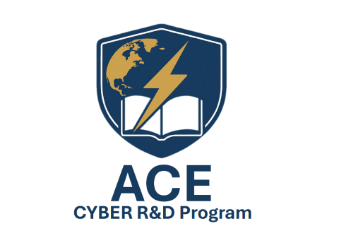
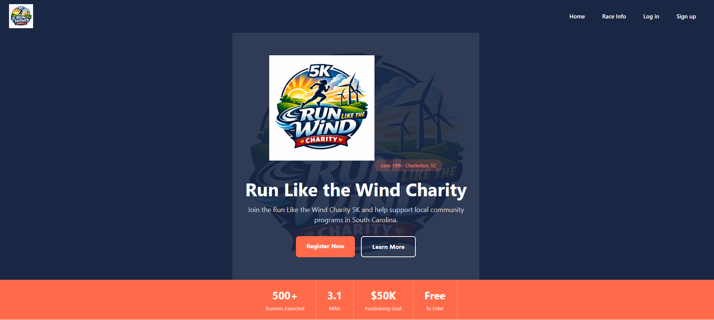
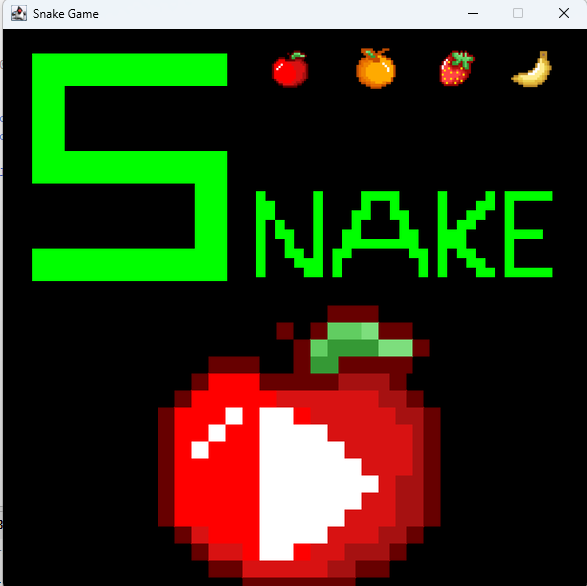
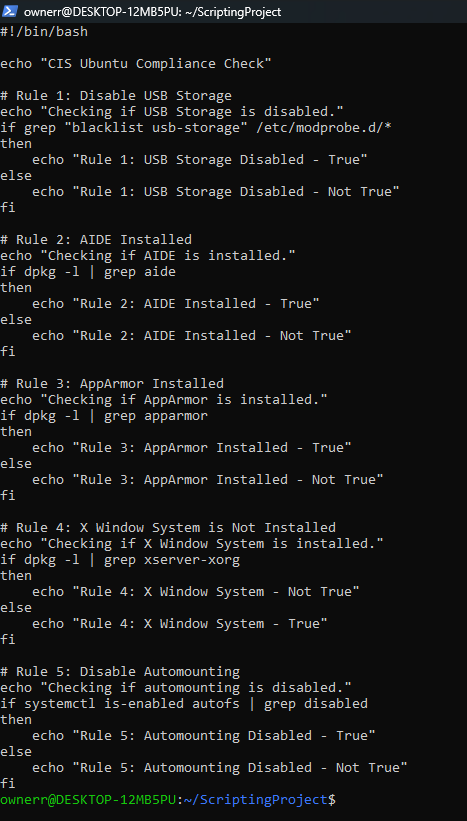
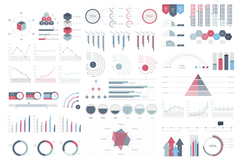

Portfolio
=========

Programming Projects
--------------------

*For access to my private project repositories, please [email me](mailto:example@csustudent.net?subject=GitHub%20Access) with the subject line, GitHub Access.

---
### [Ace Senior Project | CSCI 497,498,499](project1)

---
### [Run for a Cause 5k Website | CSCI 334](project2)

---
### [Final Project - Snake Game | CSCI 325](project3)

---
### [Final Project - CIS Ubuntu Compliance Checker | CSCI 301](project4)

---
### [Project 4 Title | CSCI 332](project5)

---

Ethics Papers
-------------

### [Analysis of the Morris Worm Incident of 1988](/pdf/Cybersecurity-Ethics-Paper-1.pdf)

-   **Class:**  Principles of Cybersecurity - CSCI 405
-   **Grade:** A

### [Five Top Viruses and Worms](/pdf/Cybersecurity-Ethics-Paper-2.pdf)

-   **Class:** Principles of Cybersecurity - CSCI 405
-   **Grade:** A

### [Object-Oriented Programming Ethics Paper](/pdf/OOP-Ethics-Paper.pdf)

-   **Class:** Object-Oriented Programming - CSCI 325
-   **Grade:** A

---

Presentations
-------------

### [Case of Gary McKinnon](/pdf/Cybersecurity-Presentation-1.pdf)

- **Class:** Principles of Cybersecurity - CSCI 405
- **Grade:** A

### [Story of Kevin Mitnick](/pdf/Cybersecurity-Presentation-2.pdf)

- **Class:** Principles of Cybersecurity - CSCI 405
- **Grade:** A

---

Page template forked from <a href="https://github.com/csu-cs/csci-portfolio">CSU-CS</a>

<!-- Remove above link if you don't want to attributive -->
