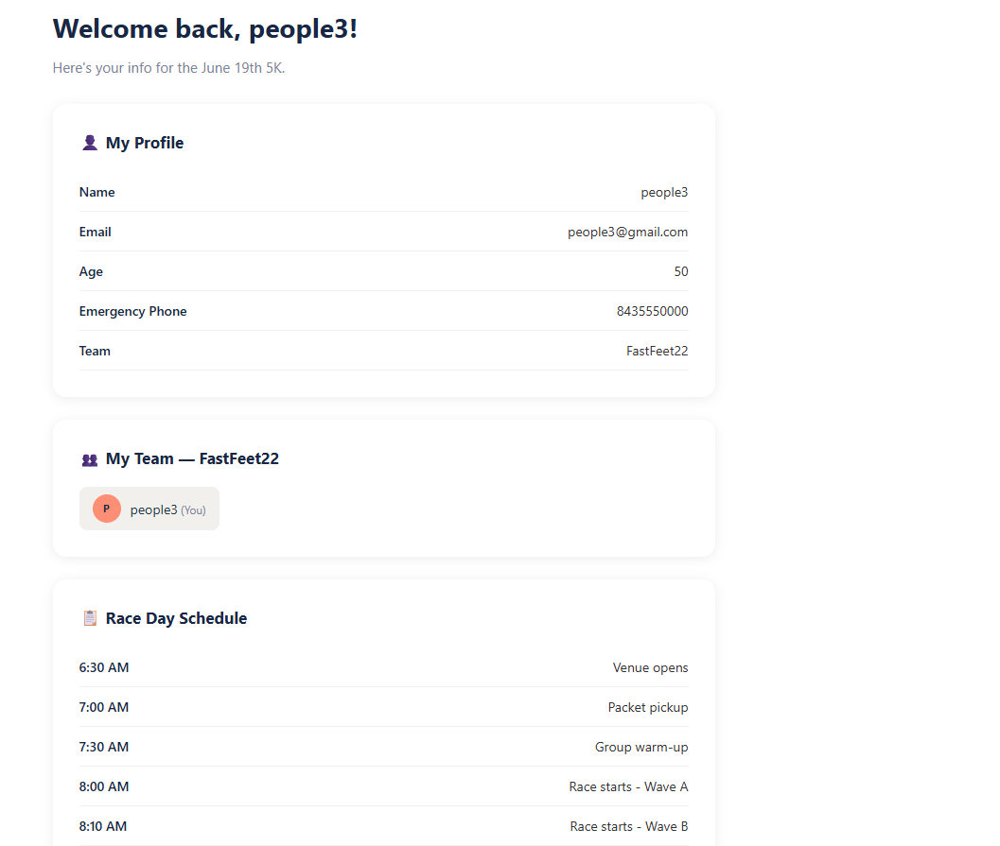
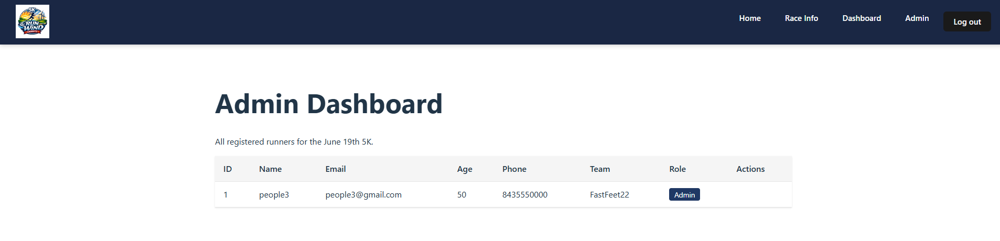

[Back to Portfolio](./)

Run for a Cause 5k Website
===============

-   **Class:** User Interface Programming - CSCI 334
-   **Grade:** A
-   **Language(s):** JavaScript, CSS, C#
-   **Source Code Repository:** [features/mastering-markdown](https://guides.github.com/features/mastering-markdown/)  
    (Please [email me](mailto:example@csustudent.net?subject=GitHub%20Access) to request access.)

## Project description

This project involved developing a full-stack web application as part of a three-person team for a fictional nonprofit hosting a 5k charity run. This website demonstrates my frontend and backend development skills, which are essential for cybersecurity. I worked alongside A'Myah Temple and Pablo Aguilar to finish this assignment. The website allows participants to register, log in, view race-day information, and access a private dashboard. It also includes an admin interface that can manage all registered runners. My main contributions to the project were developing admin management features, runner profiles, backend API improvements, and a teammate lookup function. I used CSS when working on the admin interface design.

## How to run the program

How to compile (if applicable) and run the project.

## UI Design

Almost every program requires user interaction, even command-line programs. Include in this section the tasks the user can complete and what the program does. You don't need to include how it works here; that information may go in the project description or in an additional section, depending on its significance.

Lorem ipsum dolor sit amet (see Fig 1), consectetur adipiscing elit, sed do eiusmod tempor incididunt ut labore et dolore magna aliqua. Ut enim ad minim veniam, quis nostrud exercitation ullamco laboris nisi ut aliquip ex ea commodo consequat (see Fig 2). Duis aute irure dolor in reprehenderit in voluptate velit esse cillum dolore eu fugiat nulla pariatur. Excepteur sint occaecat cupidatat non proident, sunt in culpa qui officia deserunt mollit anim id est laborum (see Fig 3).

  
Fig 1. Homepage of the Run for a Cause 5k Website.

  
Fig 2. Runner Dashboard displaying race details, teammates, and registration information.

  
Fig 3. Admin Dashboard displaying registered runners and management options.

For more details see [GitHub Flavored Markdown](https://guides.github.com/features/mastering-markdown/).

[Back to Portfolio](./)
