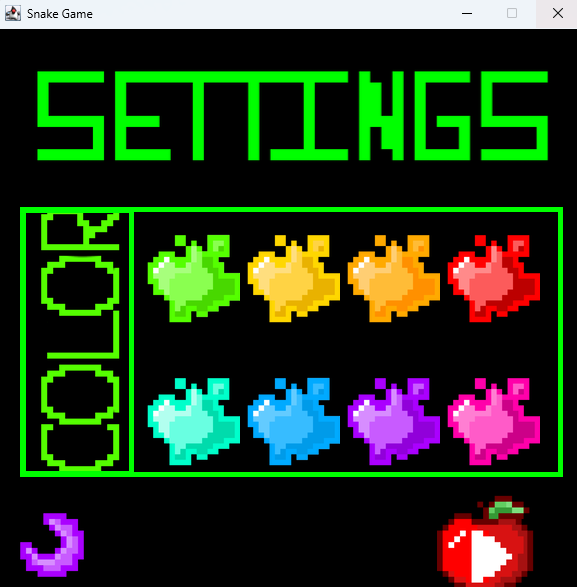
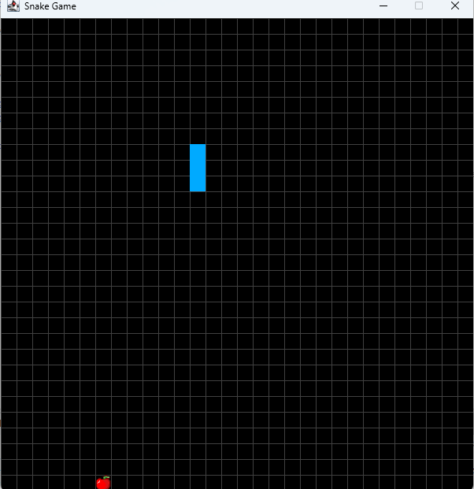
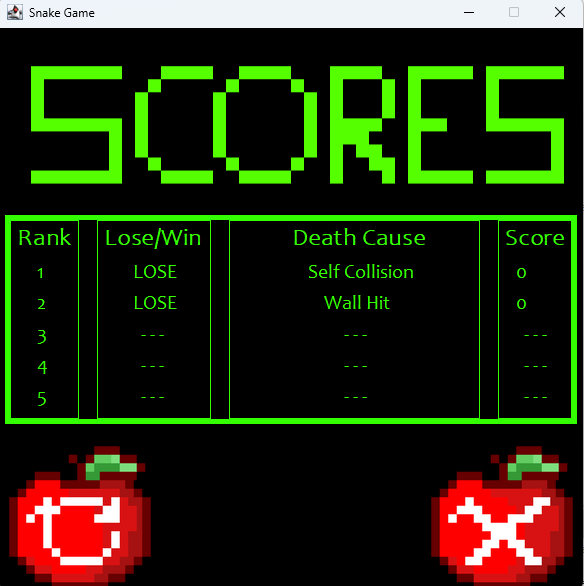

[Back to Portfolio](./)

Java Snake Game
===============

-   **Class:** Object-Oriented Programming - CSCI 325
-   **Grade:** A
-   **Language(s):** Java
-   **Source Code Repository:** [Java Snake Game](https://github.com/csu-cs/csci325-Fall25-Snake)  
    (Please [email me](mailto:DLJefferson@student.csuniv.edu?subject=GitHub%20Access) to request access.)

## Project description

This was a semester-long group project where we recreated the classic Snake game using Java. I worked alongside Danielle Rodriguez, Jalyn Green, Jessica Gambino, and Teaundra Thompson. The game allows players to customize their snake, collect different fruits, avoid obstacles, and view their scores. My main contribution was developing the Background class, which displayed the game board, snake, and fruit while managing the boundaries of the playing area.

## How to run the program

To run the game, download the project from the GitHub repository and extract the files. Open Apache NetBeans, select File --> Open Project, and choose the CSCI325_Snake folder. Once the project loads, click Run Project to compile and launch the game.

## UI Design

The game includes a main menu, settings screen, gameplay area, and scoreboard. Players can change the snake's appearance, move using the arrow keys or WASD, and collect fruit to grow. The scoreboard displays previous results, scores, and causes of losing.

  
Fig 1. Main menu of the Snake game.

  
Fig 2. Settings screen showcasing all available color options.

  
Fig 3. Gameplay screen displaying the snake, fruit, and game board.

  
Fig 4. Scoreboard displaying game results and scores.

For more details see [GitHub Flavored Markdown](https://guides.github.com/features/mastering-markdown/).

[Back to Portfolio](./)
