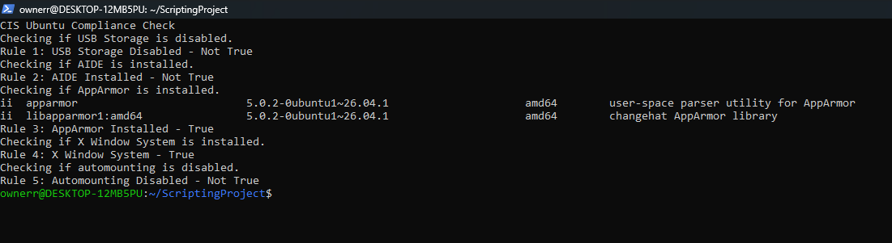

[Back to Portfolio](./)

CIS Ubuntu Compliance Checker
===============

-   **Class:** Survey of Scripting Languages - CSCI 301
-   **Grade:** A
-   **Language(s):** Bash
-   **Source Code Repository:** [CSCI 301 Code Repository](https://github.com/denzel624/CSCI-301-code-repository/tree/master/FinalProject)  
    (Please [email me](mailto:example@csustudent.net?subject=GitHub%20Access) to request access.)

## Project description

This program is a Bash script that performs five security checks based on the CIS Ubuntu Linux 20.04 Benchmark. The script checks whether USB storage is disabled, AIDE and AppArmor are installed, whether the X Window System is installed, and whether automounting is disabled. Each check displays a True or Not True result without changing system settings.

## How to run the program

Download the Bash script from the GitHub repository link. Then open Windows PowerShell in administrator mode, launch Ubuntu using the wsl command, and navigate to the folder containing the script. Run the script using bash Final to automatically perform the 5 security checks and display the results.

## UI Design

The user runs the Bash script through a Linux terminal, and the program automatically performs five security checks. The results are displayed as True or Not True. Figure 1 shows the Bash script containing the commands used for the five security checks. Figure 2 shows the results displayed after running the script.

  
Fig 1. Bash Script containing the five CIS Benchmark security checks.

  
Fig 2. Output displaying the results of the five security checks.

For more details see [GitHub Flavored Markdown](https://guides.github.com/features/mastering-markdown/).

[Back to Portfolio](./)
