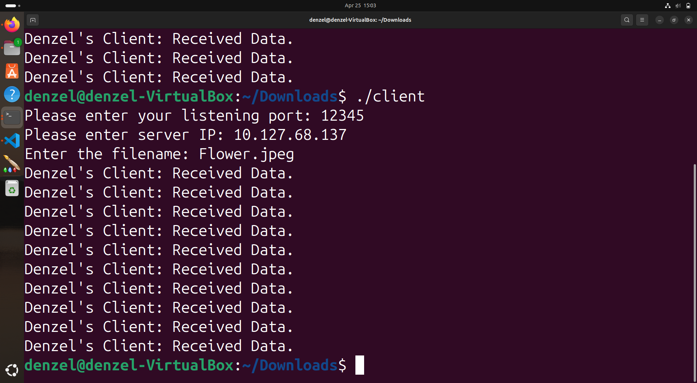
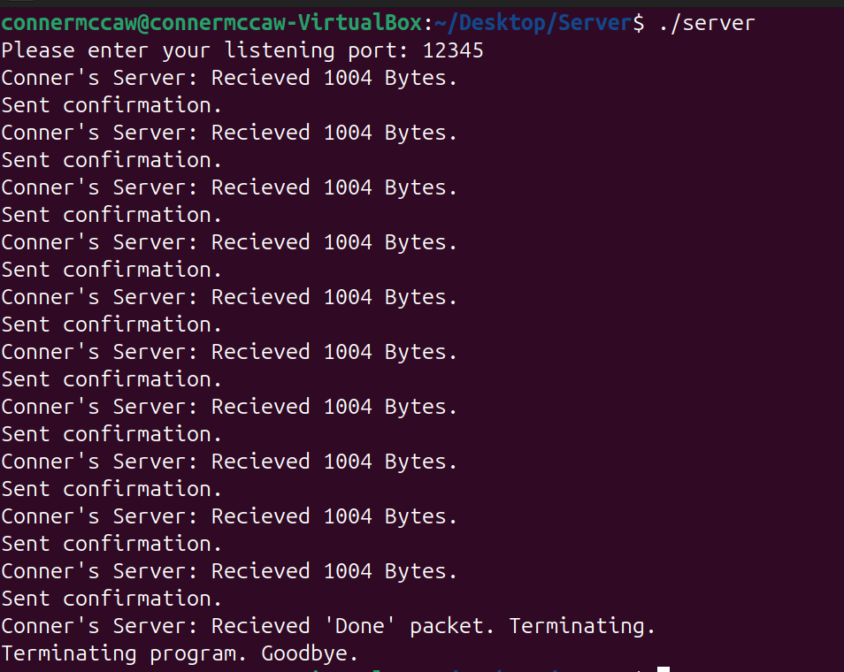

[Back to Portfolio](./)

AirDrop File Transfer Application
===============

-   **Class:** Applied Networking - CSCI 332
-   **Grade:** A
-   **Language(s):** C++
-   **Source Code Repository:** [Applied Networking Final Project](https://guides.github.com/features/mastering-markdown/)  
    (Please [email me](mailto:example@csustudent.net?subject=GitHub%20Access) to request access.)

## Project description

For our Applied Networking project, my partner and I built and configured a local area network (LAN). We created Ethernet cables, connected our computers to the network, and configured the tools needed for communication and file sharing. We experienced difficulties with the network setup, which required extensive troubleshooting. We also developed a C++ client-server application that allowed files to transfer between two computers over a network. Using Ubuntu, we tested the application and successfully demonstrated transferring an image file between the client and server.

## How to run the program

Download the client and server C++ source files from the GitHub repository. Compile both C++ files in Ubuntu. Run the server program first, followed by the client program. Enter the listening port, server IP address, and filename when prompted to begin the file transfer.

## UI Design

The application uses a command-line interface through the Ubuntu terminal. Users enter the connection information and filename to initiate a file transfer. The client will display messages confirming that data has been received, while the server displays the number of bytes and sends confirmation messages. Figure 1 shows the client receiving data, and Figure 2 shows the server processing the file transfer.

  
Fig 1. Client receiving data from the server.

  
Fig 2. Server receiving data packets and sending confirmation.

For more details see [GitHub Flavored Markdown](https://guides.github.com/features/mastering-markdown/).

[Back to Portfolio](./)
